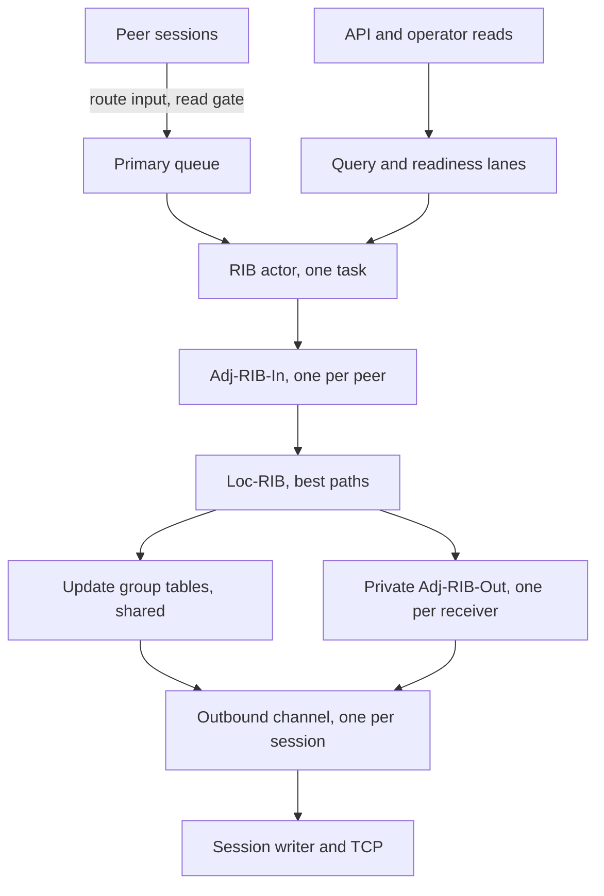
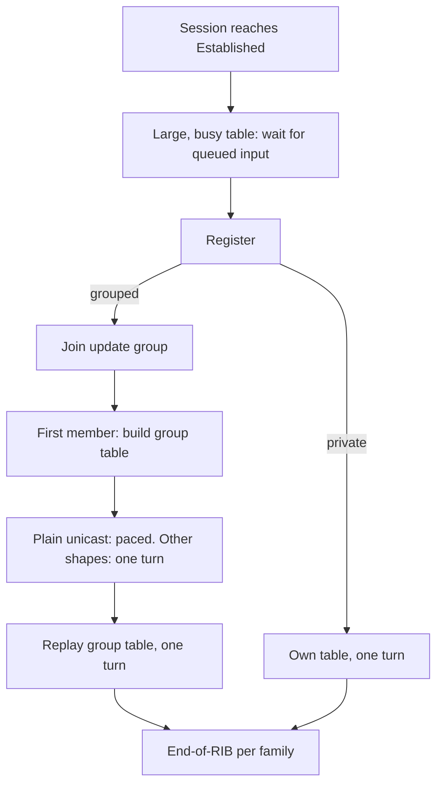
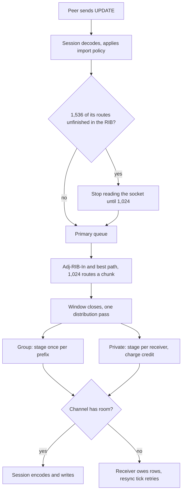
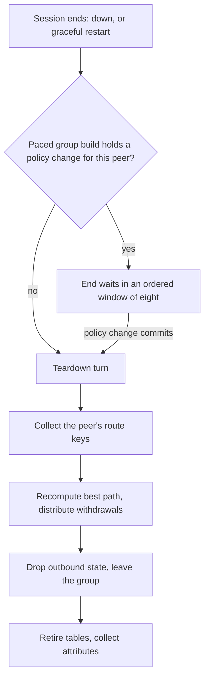

# RIB lifecycle

> **Document class: REFERENCE.**

Follow a session and its routes through the RIB, stage by stage, and see which path each session shape takes and how much of it has been measured.

The RIB is one task. It owns every received route, the best paths and
everything advertised, and it does one thing at a time. So the useful
question about any operation is: how long is the longest single turn, and
what waits behind it? The answer depends on the shape of the session. This
page gives it per shape and per stage.

It describes `main` after v0.83.0, read from the code in November 2026.
rustbgpd is public alpha overall; nothing here is a compatibility promise.
The [stability guide](stability.md) says which route-server and
route-reflector surfaces carry the narrow v1 contract and which families
(EVPN beyond scoped reflection, VPN FlowSpec, the Linux dataplane) stay
alpha. If this page and the code disagree, the code is right.

## Shape by stage

Read a row for your session shape. Each cell names the longest unit of work
at that stage.

- **paced**: the work is split into bounded turns and other peers' updates
  run between them. A named test or a public receipt shows it.
- **one turn**: one RIB turn that grows with the table (or with the routes
  of the peer or receiver involved). Every peer's updates, operator reads
  and timers wait behind it. Readiness probes are still answered at
  checkpoints inside it.
- **not measured**: no public receipt covers this shape at this stage. The
  path is from the code; its duration is unknown.

| Shape | [Comes up](#session-comes-up) | [Steady state](#steady-state) | [Falls behind](#receiver-falls-behind) | [Refresh, ORF, RTC](#refresh-orf-and-rt-constrain) | [Policy change](#policy-or-config-change) | [Restart](#restart) | [Ends](#session-ends) |
| --- | --- | --- | --- | --- | --- | --- | --- |
| Plain unicast, grouped | Table build **paced**; initial table **one turn** | **paced** by window | Resync **one turn** per member | **one turn** per request; queued requests share it | **paced**, plus two snapshot turns | **paced** | **one turn** |
| Export policy | Table build **one turn**, not measured; initial table one turn | As plain | As plain | As plain | **paced**, plus two snapshot turns | Paced path; not measured with policy | One turn |
| Configured role | As export policy; not measured | As plain; not measured | As plain; not measured | As plain; not measured | As export policy; not measured | Paced path; not measured | One turn; not measured |
| Route-server per-client best | Table build **one turn**; own initial table; not measured | Window; per-client ranking not measured | As plain; not measured | One turn per request, never shared | Per-peer path; not paced | One prefix, one member a step: slow | One turn; not measured |
| Add-Path send, and other private receivers | Initial table **one turn** per receiver; not measured | Window; work grows with receivers | **paced** row cursor; fallback resync one turn | One turn per request | Per-peer path; not measured | **paced** row cursor | One turn |
| Dual-stack (IPv4 and IPv6 unicast) | As its row above; one table holds both families | As its row above | As above, per family | Per family | As its row above | Each family released separately | One turn covers both |
| Unicast plus EVPN or VPN | Table build **one turn**; not measured | EVPN one message at a time; long turns known | EVPN **paced** cursor; VPN whole family, one turn | One turn; RT change walks the group VPN table | Per-peer path; not measured | Unicast paced; VPN and EVPN selection one turn | One turn |
| Labeled unicast | Initial table one turn; not measured | One message at a time; not measured | Whole family, **one turn**, outside credit | One turn; not measured | Not measured | Whole family, one turn per receiver; not measured | One turn; not measured |
| Group member holding a private family | Private family built in the initial-table turn | Private family staged per receiver | EVPN cursor; far behind: two walks of the group table | As the family's row | Per-peer path; not measured | Private family follows from the resync ticks | One turn |

How to read the rows:

- **Grouped** sessions share one staged table per update group. A session
  is grouped when its export result is the same as its group's for every
  route: same export-chain content, same eBGP or iBGP and reflector-client
  status, same role, same families
  ([`GroupKey`](../../crates/rib/src/manager/update_groups.rs)).
- **Private** receivers hold their own Adj-RIB-Out. Add-Path send, an
  installed ORF, an ORR vantage, conditional advertisement, an export
  policy that reads the peer, per-client best combined with VPN, and
  slow-peer isolation each make a session private for unicast
  ([`classify_update_group`](../../crates/rib/src/update.rs)).
- EVPN, labeled unicast, FlowSpec, BGP-LS and RT-Constrain rows are always
  held per receiver, even for a group member. Groups share IPv4 and IPv6
  unicast and VPN.
- The row-cursor tests use single-path private receivers. An Add-Path
  receiver takes the same cursor, keyed by prefix, and has not been
  measured on its own.
- Rows combine. A dual-stack route-server client with export policy reads
  the export-policy row (and the per-client-best row if that is set), with
  the dual-stack row for what is per family.

What backs each **paced** mark:

- *Comes up, plain unicast.* Work counts in tests, named under
  [Session comes up](#session-comes-up). Timings are not yet published.
- *Steady state.* The read-gate test named under
  [Steady state](#steady-state) and the fixed window limits. It bounds the
  input ahead of another peer's update, not the cost of one pass.
- *Falls behind, row cursor.* `a_whole_family_debt_drains_in_bounded_steps`,
  `a_step_is_at_most_one_chunk_of_keys` and
  `a_cursor_drain_is_charged_and_takes_no_operation` in
  [`tests/owed_row_cursor.rs`](../../crates/rib/src/manager/tests/owed_row_cursor.rs);
  for EVPN, `an_evpn_debt_drains_in_bounded_steps` in
  [`tests/owed_evpn_cursor.rs`](../../crates/rib/src/manager/tests/owed_evpn_cursor.rs).
  Work counts, not timings.
- *Policy change.* [ADR-0105](../adr/0105-grouped-export-policy-transition.md)
  and its [receipt](../perf/prestaged-transition-inventory-2026-10.md): 700
  peers with export policy, 400,400 prefixes.
- *Restart, grouped unicast.* The tests named under [Restart](#restart).
  Work counts; no public timing.
- *Restart, private receivers.* The selection-release entry in
  [known issues](known-issues.md): 150 private receivers, 150,000 rows, in
  the transport harness.

### Worked example: a route-server client joins a 1M-route table

A dual-stack route-server client with an export policy reaches Established
while the Loc-RIB holds one million best routes.

1. **Registration is queued.** With 10,000 or more best routes and other
   input waiting, the RIB finishes the queued route input first. Under a
   sustained feed the client waits for the queue to empty.
2. **Its group table may have to be built, in one turn.** Group identity
   includes the content of the export chain. If no established client has
   the same chain and profile, this client is the first member and the RIB
   builds the group's table from the whole Loc-RIB, both families, with
   export policy evaluated per route. The paced build does not apply: it
   covers only sessions with no export policy, no role, no route-server
   control and no per-client best. The turn grows linearly with the table.
   At one million routes expect seconds, not milliseconds; every other
   peer's updates wait for it. **Not measured** for this shape in any
   public receipt.
3. **Its initial table is one more turn.** The RIB replays the group table
   to the client, less the client's own routes, as one whole-table
   operation, then sends End-of-RIB for each family. If the group is plain
   (not per-client best), up to 64 queued joiners of the same group share
   one replay. A per-client-best joiner always gets its own.
4. **From then on it is a group member.** A changed prefix is evaluated
   once for the group, not once per client.

What has been measured, and at what shape:

- The shared replay: 50 simultaneous rejoins on a 700-member IPv4 route
  server with 400,400 prefixes, group table already built
  ([receipt](../perf/join-cohort-converged-rejoin-2026-10.md)).
- New members joining a 702-member dual-stack route server with export
  policy and 200,200 prefixes per family: a pass against a 60-second
  complete-export limit, not a turn-length measurement
  ([receipt](../perf/ixp-membership-churn-qualified-2026-09.md)).
- The paced build, for the plain shape only: work counts in tests (below).
  Timings at 400,000 and 1,000,000 routes exist but are not yet published.
- Nothing public at one million routes for a client with export policy,
  a role or per-client best.

## Overview

Sessions and the API feed one actor through separate queues; the actor
owns the received routes, the best paths and both kinds of advertised
table, and hands updates to each session over a bounded channel.

- **Primary queue.** Route input, session up and down, End-of-RIB,
  refresh requests and commands, served in arrival order. One bounded
  channel, 4,096 entries by default.
- **Query, summary and readiness lanes.** Operator reads have their own
  lanes ([ADR-0132](../adr/0132-operator-read-path.md)). The readiness
  lane is also served at checkpoints inside long turns, so a liveness or
  readiness probe is answered while route updates wait.
- **Resync tick.** A timer, one second after work is first owed and 10 ms
  while a backlog remains. It retries receivers whose channel was full and
  delivers owed rows. One tick works for about 25 ms.
- **Background owners.** A paced group build, a paced restart release and a
  policy pre-stage each take alternate turns with the primary queue.

The loop is `run_actor` in
[`manager/mod.rs`](../../crates/rib/src/manager/mod.rs). The
[architecture page](../explanation/architecture.md#runtime-model) shows
where this actor sits among the daemon's other tasks.

## Session comes up

A new session registers at once on a quiet or small RIB and waits behind
queued input on a large busy one. A group's first member builds the group
table, in paced turns only for a plain unicast session; a later member
skips the build. Every session then gets its table in one turn.

**Registration.** The transport sends `PeerUp` with the negotiated families
and the session's outbound channel. `register_active_session` in
[`peer_lifecycle.rs`](../../crates/rib/src/manager/peer_lifecycle.rs)
completes the registration inline unless the Loc-RIB has at least 10,000
routes and the actor has queued work. Deferred registrations run one at a
time, only when no route batch or primary input is waiting.

**Group or private.** The session's negotiated state and export chain are
classified. A groupable session joins the group with its key, creating it
if needed. Any other session keeps its own Adj-RIB-Out.

**First member of a group.** The group has no table yet.

- *Paced build.* `prospective_first_group` in
  [`membership.rs`](../../crates/rib/src/manager/update_groups/membership.rs)
  admits a session that negotiated only IPv4 or IPv6 unicast and has no
  export policy, no role, no route-server control and no per-client best.
  It also refuses an iBGP non-client on a route reflector and any family
  still inside a restart selection hold.
  [`first_group_build.rs`](../../crates/rib/src/manager/first_group_build.rs)
  then builds the table privately. Each turn visits at most 1,024 Loc-RIB
  hash buckets or repairs at most 1,024 keys that changed behind the walk,
  and route input takes the turns in between. The table is published only
  when complete, so no joiner sees part of it. If more than 4,096 distinct
  keys change before the walk can repair them, the partial table is
  retired, 1,024 slots a turn, and the build starts again.
  - Tests: `registration_finishes_discovery_and_repairs_under_continuing_changes`
    and `registration_coalesces_repairs_and_invalidates_on_the_first_excess_key`
    in [`loc_rib.rs`](../../crates/rib/src/loc_rib.rs) bound a turn's work;
    `imports_during_unpublished_build_reach_both_joiners_before_eor` in
    [`tests/first_group_build.rs`](../../crates/rib/src/manager/tests/first_group_build.rs)
    shows updates installing during a build.
  - Not measured: a build under sustained input above the repair rate,
    which can restart repeatedly. No public timing receipt yet.
- *One-turn build.* Every other grouped session takes `ensure_group_table`:
  one turn that walks the whole Loc-RIB and stages every family the group
  owns. That includes every session with export policy, a role,
  route-server control or per-client best, and any session that also
  negotiated VPN, EVPN or another non-unicast family. Not measured for
  those shapes.

**Initial table.** `send_initial_table` replays the group table (or, for a
private receiver, walks the Loc-RIB) and commits the result in one turn. It
is a whole-table operation: one per peer at a time, not charged against the
receiver's row credit ([`outbound_credit.rs`](../../crates/rib/src/outbound_credit.rs)).
Private families (EVPN, labeled unicast and the rest) are built in the same
turn. End-of-RIB for each family follows its routes.

- Queued joiners of one plain group share a replay: up to 64 registrations
  complete in one turn from one payload (`take_join_cohort`). Per-client
  best groups and sessions with Add-Path, ORF, ORR or conditional
  advertisement do not share.
- Measured: the shared replay at 700 IPv4 route-server members and 400,400
  prefixes ([receipt](../perf/join-cohort-converged-rejoin-2026-10.md)).
  A full-table ROUTE-REFRESH replay of one family, which uses the same
  group replay, held the actor for 211–246 ms at 700 route-server peers
  and 400,400 IPv4 prefixes
  ([receipt](../perf/route-refresh-readiness-2026-10.md)).
- Not measured: the initial table at one million routes, for any shape.
  Splitting it into bounded turns is not on main.

## Steady state

Each session's input is gated at the socket, installed in chunks, and
distributed once per window to groups and private receivers; a receiver
that cannot take an update is retried by the resync tick.

**Read gate.** A session charges every route it sends to the RIB against
its own budget and stops reading its socket at 1,536 unfinished routes,
resuming at 1,024 ([`ingest_budget.rs`](../../crates/rib/src/ingest_budget.rs),
[ADR-0078](../adr/0078-inbound-rib-backpressure.md)). One peer's burst
therefore puts about two full UPDATEs ahead of another peer's update, not
the whole burst. Test:
`unpaced_burst_leaves_at_most_two_messages_ahead_of_another_source` in
[`tests/ingest_budget.rs`](../../crates/transport/src/session/tests/ingest_budget.rs).
The wait still grows with the number of peers bursting at once, and input
that does not come from a session is not gated.

**Install and select.** A message's routes enter the peer's Adj-RIB-In in
chunks of 1,024, and best path is recomputed for the affected prefixes.
Reads and the readiness lane are served between chunks.

**Distribution window.** Unicast route input already queued is coalesced
into one window: up to 256 messages, 4,096 routes, 1,024 distinct prefixes
or 5 ms, whichever comes first
([`DistributionWindowLimits`](../../crates/rib/src/manager/distribution/mod.rs)).
The window ends with one distribution pass over its affected prefixes. EVPN
and FlowSpec input never joins a window; VPN and labeled unicast arrive as
their own messages. Each of those is distributed message by message.

**Groups.** For each group and changed prefix the export gates and policy
run once. Members get the shared result, each less its own routes
([ADR-0099](../adr/0099-update-groups-v2.md); encode sharing in
[ADR-0109](../adr/0109-update-group-shared-encode.md); per-client best in
[ADR-0126](../adr/0126-shared-group-per-client-best.md)).

**Private receivers.** The same pass stages each private receiver in turn,
so its cost grows with receivers times changed rows. Two known long turns
remain on main. An EVPN burst toward many private receivers grows every
receiver's table inside one inbound message
([known issues](known-issues.md)). A unicast advertised table moves memory
in proportion to its size when its prefix index doubles
([`adj_rib_out.rs`](../../crates/rib/src/adj_rib_out.rs)); that cost has a
work count in a unit test and no timing.

**Credit and channel.** An update toward a private receiver is admitted
only while the receiver's unsent private rows are under its row credit: a
daemon-wide 16,777,216 rows divided among registered peers, between 8,192
and 1,048,576 each. A refused or full channel never blocks the RIB. The
receiver is marked as owing and the resync tick retries it
([Receiver falls behind](#receiver-falls-behind)).

**Wire.** The session builds UPDATEs from the handed-over routes
(AS_PATH, NEXT_HOP, the negotiated encodings) and its writer sends them.
The writer's queued bytes are bounded
([receipt](../perf/writer-byte-budget-2026-11-07.md)).

What "paced by window" in the matrix rests on: the read gate test above and
the window limits. No public receipt times an unrelated peer's wait at a
stated receiver count on main; the figures in known issues are single
untimed harness runs and say so.

## Receiver falls behind

When a receiver's channel is full or its credit is spent, the RIB records
which rows it is owed and the resync tick delivers them later; this
section, with the row cursor, eviction and resync in full, is the next
addition to this page. Until then see the
[Falls behind column](#shape-by-stage), the module doc of
[`outbound_owing.rs`](../../crates/rib/src/manager/outbound_owing.rs) and
[known issues](known-issues.md).

## Refresh, ORF and RT-Constrain

A ROUTE-REFRESH answer, an ORF change and a route-target membership change
each resend part of a table to one receiver; each answer is one
whole-table operation today, and compatible queued refreshes of one plain
group share a replay
([receipt](../perf/shared-route-refresh-2026-10-11.md), 200-peer IPv4 route
reflector, 400,000 prefixes). The full section is still to be written; see
the [Refresh, ORF, RTC column](#shape-by-stage).

## Policy or config change

An export-policy change moves sessions between update groups. A clean,
unicast-only, single-best cohort moves as one paced transaction of at most
1,024 routes or eight members a turn, with two table-sized snapshot turns
([ADR-0105](../adr/0105-grouped-export-policy-transition.md);
[receipt](../perf/prestaged-transition-inventory-2026-10.md), 700 peers,
400,400 prefixes). Everything else takes the per-peer path. The full
section is still to be written; see the
[Policy change column](#shape-by-stage) and the
[reload matrix](reload-matrix.md).

## Restart

After a planned restart the RIB holds route selection until its restarting
peers send End-of-RIB or the deferral timer expires (RFC 4724), then
releases each family. IPv4 and IPv6 unicast release in batches of at most
1,024 prefixes delivered to 16 group members a step
(`one_release_poll_admits_only_a_bounded_page_of_group_members` in
[`tests/paced_selection_release.rs`](../../crates/rib/src/manager/tests/paced_selection_release.rs)).
A per-client-best group is the exception on main: inside a batch it is
ranked and delivered one prefix at a time and one member a step, so its
release takes far longer and holds other input for the length of a batch.
The full section is still to be written; see the
[Restart column](#shape-by-stage).

## Session ends

A session end normally runs at once as one turn sized by the peer's routes;
behind a paced group build that holds a policy change for the same peer it
waits, in order, while other peers' route input keeps flowing.

**Which end.** A plain `PeerDown` removes the peer's routes. A graceful
restart end keeps them as stale and starts the restart timer instead
([architecture](../explanation/architecture.md#graceful-restart-receiving)).
An end from a session that a newer session of the same peer replaced is
discarded, and an end of the active session while a second live session
remains fails the registration over to the survivor
(`handle_peer_down` and `classify_session_teardown` in
[`peer_lifecycle.rs`](../../crates/rib/src/manager/peer_lifecycle.rs)).

**The teardown turn.** `peer_down_teardown` does all of this in one turn:

1. Collects every key the peer announced, in every family.
2. Recomputes best path for those keys and runs one distribution pass, so
   withdrawals and replacement routes go out to every other peer.
3. Drops the peer's outbound state: its owed rows, its private Adj-RIB-Out,
   its group membership. If it was the last member, the group's table is
   retired in the same turn.
4. Frees the peer's Adj-RIB-In and collects unused attributes.

The turn grows with the routes the peer announced, plus the table it was
sent if that table is retired. A peer that announced a full table is a
table-sized turn. The readiness lane is served at checkpoints throughout;
route updates, operator reads and timers wait.

- Measured: readiness during the cleanup phases, removing 1,230,000 keys
  on a hosted VM. Unicast: longest gap between checkpoints under 2 ms,
  in-process readiness replies within 50 ms. VPN: under 10 ms and within
  82 ms
  ([receipt](../perf/peer-teardown-cleanup-readiness-7ff33596-2026-10-16.md)).
  That receipt times cleanup, not the recompute and withdrawal pass.
- Tests: `peer_down_burst_work_is_linear` in
  [`tests/work_scaling.rs`](../../crates/rib/src/manager/tests/work_scaling.rs)
  pins that a burst of session ends does work linear in the group's size,
  not members times withdrawals.
- Not measured: how long an unrelated peer's update waits behind the end
  of a full-table peer, at any shape.

**What waits behind it.** Normally nothing waits on a session end; it runs
when it reaches the head of the primary queue. The exception is a paced
first-member build with a claimed export-policy change:

- A policy change that needs the table under construction is parked until
  the table is ready. A session end for a peer that change names must run
  after it. The end is kept in an ordered window of at most eight commands
  and session ends, and runs right after the policy change commits
  ([`first_group_order.rs`](../../crates/rib/src/manager/first_group_order.rs)).
- While it waits, only unicast, labeled-unicast, VPN and EVPN route input
  from other peers passes it. End-of-RIB, FlowSpec, BGP-LS and
  RT-Constrain input, operator reads on the primary queue, commands,
  other session changes and the same peer's later messages all wait for
  the rest of the build.
- The queue is held completely, as before, when a ninth command or end
  arrives, when a stale-route or refresh timer falls due, or when passing
  input overflows the build's repair log.
- While the end waits the peer's routes stay selected and advertised.
- Tests: `unrelated_update_passes_a_session_end_that_waits_for_the_cold_build`,
  `only_plain_route_input_from_another_peer_passes_a_retained_session_end`
  and `full_window_holds_the_ninth_session_end_at_the_head` in
  [`tests/first_group_build.rs`](../../crates/rib/src/manager/tests/first_group_build.rs).
- Not measured: the length of the hold at 400,000 or 1,000,000 routes, or
  with periodic primary-queue reads (BMP statistics, EVPN dataplane
  queries) that re-hold the queue. A mass disconnect during a build
  exceeds the window of eight and holds the queue.

## Invariants

The invariants the RIB keeps across these stages, and the tests that pin
each, will be listed here with the remaining stages. Two are already
stated above: a group table is never visible while partly built, and a
family's End-of-RIB never precedes the routes it covers.
