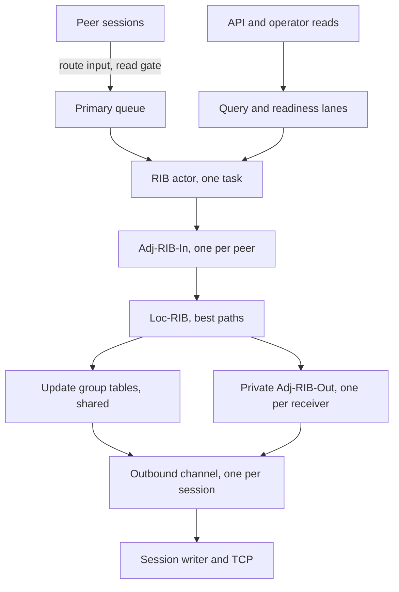
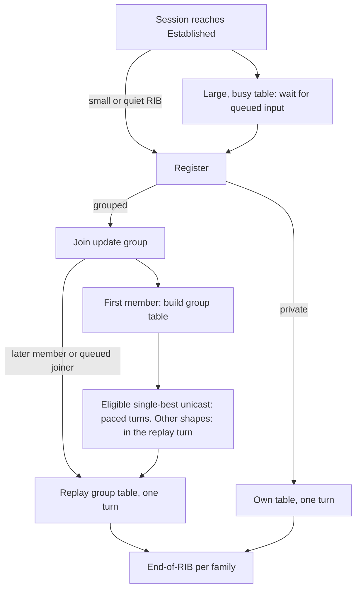
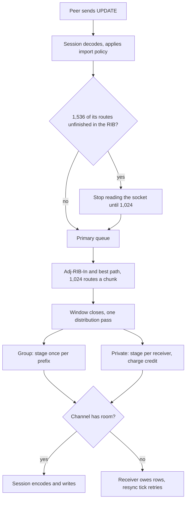
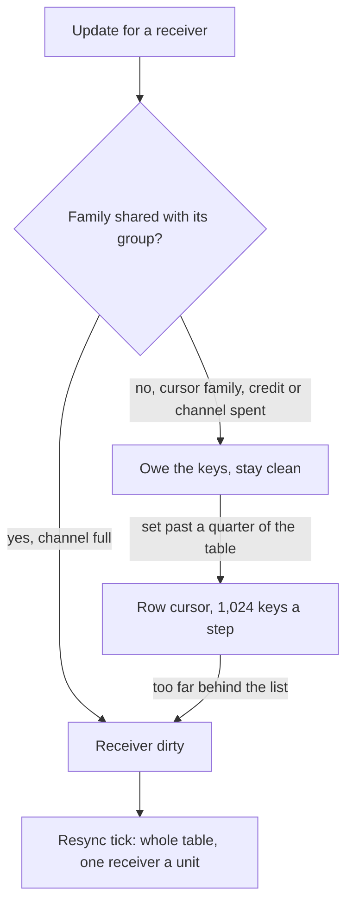
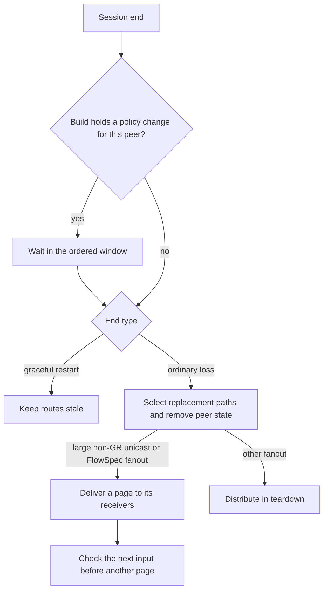

# RIB lifecycle

> **Document class: REFERENCE.**

Follow a session and its routes through the RIB, stage by stage, and see which path each session shape takes and how much of it has been measured.

The RIB is one task. It owns every received route, the best paths and
everything advertised, and it does one thing at a time. So the useful
question about any operation is: how long is the longest single turn, and
what waits behind it? The answer depends on the shape of the session. This
page gives it per shape and per stage.

It describes v0.84.0 and changes on main through November 23, 2026.
rustbgpd is public alpha overall; nothing here is a compatibility promise.
The [stability guide](stability.md) says which route-server and
route-reflector surfaces carry the narrow v1 contract and which families
(EVPN beyond scoped reflection, VPN FlowSpec, the Linux dataplane) stay
alpha. If this page and the code disagree, the code is right.

## Shape by stage

Read a row for your session shape. Each cell names the longest unit of work
at that stage.

- **paced**: the work is split into bounded turns *and other peers' updates
  run between them*. A named test or a public receipt shows it.
- **bounded turns**: the work is split into turns, and readiness probes are
  answered between them, but other peers' updates stay queued until the
  whole operation (or the stated part of it) finishes. Splitting work into
  turns is not the same as admitting unrelated input.
- **one turn**: one RIB turn that grows with the table (or with the routes
  of the peer or receiver involved). Every peer's updates, operator reads
  and timers wait behind it. Readiness probes are still answered at
  checkpoints inside it.
- **not measured**: no public receipt covers this shape at this stage. The
  path is from the code; its duration is unknown.

Turn sizes named on this page (1,024 routes, 8 or 16 members, 25 ms) are
strides and budgets checked between units of work, not hard caps. A turn
finishes the unit it is in, and one unit can be a whole table.

| Shape | [Session comes up](#session-comes-up) | [Steady state](#steady-state) | [Receiver falls behind](#receiver-falls-behind) | [Refresh, ORF, RTC](#refresh-orf-and-rt-constrain) | [Policy change](#policy-or-config-change) | [Restart](#restart) | [Session ends](#session-ends) |
| --- | --- | --- | --- | --- | --- | --- | --- |
| Plain unicast, grouped | Table build **paced** ([receipt](../perf/first-group-build-registration-2026-11.md)); initial table **paced** from 10,000 routes | **paced** by read gate and window | Resync **paced** from 10,000 routes | **one turn** per request; queued requests share it | Nothing filtered: **bounded turns**, updates held until commit. Otherwise one shared turn | **paced** between batches; input held inside a batch | Selection **one turn**. Large fanout **paced** |
| Group-shareable export policy | Single-best unicast table build and initial table **paced** | As plain | As plain | As plain | As plain | As plain; not measured with policy | As plain. Policy shape not measured |
| Route-server control, single best | Table build **one turn**, with the first client's control index; initial table **paced** from 10,000 routes, also for each client of a rejoining cohort | As plain; not measured | As plain; not measured | As plain; not measured | As plain; not measured | As plain; not measured | As plain; not measured |
| Configured role | Table build and initial table together in **one turn**; not measured | As plain; not measured | As plain; not measured | As plain; not measured | As plain if nothing is OTC-blocked; not measured | As plain; not measured | As plain. Role shape not measured |
| Route-server per-client best | Cold policy-free, role-free eBGP unicast group build and initial table **paced**; with export policy, initial table **one turn** | Window; per-client ranking not measured | As plain; not measured | One turn per request, never shared | Shared cohort **one turn**; other members **paced** by command; not measured | **paced** between batches, as plain; a crowded prefix alone | Selection **one turn**. Large fanout uses narrow key pages |
| Kept private: ORF, ORR, conditional advertisement, peer-context policy, slow-peer isolation | Initial table **one turn** per receiver; not measured | Window; work grows with receivers | **paced** row cursor; fallback resync one turn | One turn per request | Members **paced** by command, a whole-table resync each; not measured | **paced** row cursor | Large fanout **paced**. Private single-best measured |
| Add-Path send | As kept private; not measured | As kept private | As kept private; not measured with several paths | One turn per request | As kept private | As kept private; not measured with several paths | Large fanout uses narrow key pages. Not measured |
| Dual-stack (IPv4 and IPv6 unicast) | As its row above; one table holds both families | As its row above | As above, per family | Per family | As its row above | Each family released separately | One selection turn, separate unicast pages per AFI |
| Unicast plus EVPN or VPN | Table build and initial table together in **one turn**; not measured | EVPN fanout in **bounded turns**; later input waits for it | EVPN and private VPN **paced** cursor; grouped VPN: member resync one turn | One turn; RT change walks the group VPN table | Members **paced** by command; not measured | Unicast as plain; VPN and EVPN selection one turn, private rows by cursor | Large unicast fanout **paced**. EVPN and VPN in teardown turn |
| Labeled unicast | Initial table one turn; not measured | One message at a time; not measured | **paced** cursor per AFI; fallback resync one turn | One turn; not measured | Members **paced** by command; not measured | Selection one turn; rows by cursor; not timed | Labeled routes in teardown turn. Not measured |
| Group member holding a private family | Private family built in the initial-table turn | Private family staged per receiver | EVPN or labeled cursor; far behind: a capture of the group table | As the family's row | Members **paced** by command; not measured | Private family follows from the resync ticks | By family. Large unicast and FlowSpec fanout **paced** |

How to read the rows:

- **Grouped** sessions share one staged table per update group. A session
  is grouped when its export result is the same as its group's for every
  route: same export-chain content, eBGP or iBGP and reflector-client
  status, role, RFC 1997 community handling, per-client best, LLGR
  families, shared families (IPv4 and IPv6 unicast, VPNv4 and VPNv6) and
  whether RT-Constrain was negotiated
  ([`GroupKey`](../../crates/rib/src/manager/update_groups.rs)).
  RT-Constrain is not a shared family: its rows stay private to each
  session, grouped or not (`owing_family_in_scope` in
  [`outbound_owing.rs`](../../crates/rib/src/manager/outbound_owing.rs)).
- **Kept private** sessions hold their own unicast Adj-RIB-Out although
  their families could be shared. The classifier
  ([`classify_update_group`](../../crates/rib/src/update.rs)) keeps a
  session out of every group, in this order of precedence, when:
  - its export policy reads the peer (peer-context policy);
  - it sends Add-Path (its own row, because it holds several paths per
    prefix);
  - it has per-client best together with VPN or RT-Constrain (per-client
    best on unicast alone is grouped: its own row);
  - it has an ORR vantage (optimal route reflection);
  - it has an ORF installed by the peer;
  - it has conditional advertisements attached.

  Slow-peer isolation is decided at run time, not by the classifier: with
  `slow_peer_isolation` set, a group member flagged slow is taken out of
  its group and kept private until the flag clears (`no_policy_group_key`
  in [`membership.rs`](../../crates/rib/src/manager/update_groups/membership.rs)).
  All of these read the kept-private row.
- **Group member holding a private family** is a different case: a session
  that shares unicast with its group while it also negotiated a family the
  RIB never shares. EVPN, labeled unicast, FlowSpec, BGP-LS and
  RT-Constrain rows are always held per receiver, even for a group member.
  Groups share IPv4 and IPv6 unicast and VPN.
- Most row-cursor tests use single-path private receivers. An Add-Path
  receiver takes the same cursor, keyed by prefix; one that is sent every
  path of a prefix takes one prefix (VPN: one key) a step in the labeled
  and VPN tests. No Add-Path cursor has been timed.
- Rows combine. A dual-stack route-server client with export policy reads
  the export-policy row (and the per-client-best row if that is set), with
  the dual-stack row for what is per family.

What backs each **paced** and **bounded turns** mark:

- *Comes up, plain unicast.* The
  [first-group build receipt](../perf/first-group-build-registration-2026-11.md),
  and the work counts in tests named under
  [Session comes up](#session-comes-up). At 1M routes, during the first
  policy-free plain-unicast group build, unrelated UPDATE latency fell from
  2,209 ms to 0.60 ms. The same receipt times the single-turn initial
  replay for that policy-free shape. The group-shareable export-policy row
  uses the work-count and synchronous-result tests described below.
- *Steady state.* The read-gate test named under
  [Steady state](#steady-state) and the window thresholds. It bounds the
  input ahead of another peer's update, not the cost of one pass.
- *Falls behind, row cursor.* `a_whole_family_debt_drains_in_bounded_steps`,
  `a_step_is_at_most_one_chunk_of_keys` and
  `a_cursor_drain_is_charged_and_takes_no_operation` in
  [`tests/owed_row_cursor.rs`](../../crates/rib/src/manager/tests/owed_row_cursor.rs);
  for EVPN, `an_evpn_debt_drains_in_bounded_steps` in
  [`tests/owed_evpn_cursor.rs`](../../crates/rib/src/manager/tests/owed_evpn_cursor.rs);
  for labeled unicast,
  `a_labeled_release_drains_in_steps_of_one_chunk_charged_and_unlatched` in
  [`tests/owed_labeled_cursor.rs`](../../crates/rib/src/manager/tests/owed_labeled_cursor.rs);
  for VPN, `a_vpn_release_drains_in_steps_of_one_chunk_charged_and_unlatched`
  in [`tests/owed_vpn_cursor.rs`](../../crates/rib/src/manager/tests/owed_vpn_cursor.rs).
  Work counts, not timings. The cursor runs from the resync tick, and route
  input is served between ticks.
- *Policy change, clean cohort: bounded turns.*
  [ADR-0105](../adr/0105-grouped-export-policy-transition.md) and its
  [receipt](../perf/prestaged-transition-inventory-2026-10.md): 700 peers
  with export policy, 400,400 prefixes. The path takes only a change that
  filters no route in either the old or the new group (an attribute-only
  change). While the transition is pending
  the actor serves readiness at every poll and a bounded number of reads
  between the polls before commit; route input, timers and resync work
  stay queued until the commit finishes or the transition falls back
  (`run_actor` in [`manager/mod.rs`](../../crates/rib/src/manager/mod.rs)).
- *Policy change, members paced by command.*
  `paced_reload_matches_the_per_peer_reference_with_route_chunks_between_steps`
  and `paced_budget_admits_exactly_while_the_predicted_turn_fits` in
  [`tests/evpn_policy_pacing.rs`](../../crates/rib/src/manager/tests/evpn_policy_pacing.rs).
  Ordering and work counts on an EVPN shape; no timing for any shape.
- *Restart, grouped unicast and per-client best.* The tests named under
  [Restart](#restart). Work counts; no public timing.
- *Restart, private receivers.* The selection-release entry in
  [known issues](known-issues.md): 150 private receivers, 150,000 rows, in
  the transport harness; the longest unrelated-peer gap was 0.38–0.52 s
  (86–94 s for one turn before the fix).
- *Session ends.* The [departure tests](../../crates/rib/src/manager/tests/source_departure.rs)
  admit an independent UPDATE between pages for grouped unicast, private
  unicast and FlowSpec. The [departure receipt](https://github.com/lance0/rustbgpd/pull/3933)
  measures private single-path convergence at 150 receivers × 37,000 routes.
  The initial teardown turn and the limits on admission are described under
  [Session ends](#session-ends).

### Worked example: a route-server client joins a 1M-route table

A dual-stack route-server client with route-server control and an export
policy reaches Established
while the Loc-RIB holds one million best routes.

1. **Registration is queued.** With 10,000 or more best routes and other
   input waiting, the RIB finishes the queued route input first. Under a
   sustained feed the client waits for the queue to empty.
2. **Its group table may have to be built, inside the registration
   turn.** Group identity includes the content of the export chain. If no
   established client has the same chain and profile, this client is the
   first member and the RIB builds the group's table from the whole
   Loc-RIB, both families, with export policy evaluated per route. The
   route-server control on this session keeps it on the synchronous path.
3. **Its initial table follows in pages.** A single-best client receives
   the group table, less its own routes and the rows its RFC 7947 controls
   suppress, in pages of about 1,024 keys, then End-of-RIB for each family
   (the paged replay under [Session comes up](#session-comes-up)). Other
   peers' updates run between pages. A per-client-best client with an
   export policy still receives its whole table in the registration turn.

   The build, when this client is the first member, is one blocking
   registration turn, so every other peer's updates wait for it. It grows
   linearly with the table. The 1M-route cost of this join is **not measured** for this
   shape in any public receipt. The nearest measurement is of a different
   shape: before the paced build, a plain IPv4 session with no policy held
   the actor for about 2.2 s at one million routes, build and replay
   together
   ([receipt](../perf/first-group-build-registration-2026-11.md)). Policy
   evaluation and a second family add to that by an amount nobody has
   measured.
4. **From then on it is a group member.** A changed prefix is evaluated
   once for the group, not once per client.

What has been measured, and at what shape:

- The shared replay: 50 simultaneous rejoins on a 700-member IPv4 route
  server with 400,400 prefixes, group table already built
  ([receipt](../perf/join-cohort-converged-rejoin-2026-10.md)).
- New members joining a 702-member dual-stack route server with export
  policy and 200,200 prefixes per family: a pass against a 60-second
  complete-export limit, not a turn-length measurement
  ([receipt](../perf/ixp-membership-churn-qualified-2026-09.md)).
- The paced build, for the plain shape only: one iBGP route-reflector client,
  IPv4 unicast, no export policy, at 400,000 and 1,000,000 routes in an
  in-process harness
  ([receipt](../perf/first-group-build-registration-2026-11.md)). The
  initial table after the build was still one turn of 1.3–1.4 s at one
  million routes.
- Nothing public at one million routes for a client with export policy,
  a role or per-client best.

## Overview

Sessions and the API feed one actor through separate queues; the actor
owns the received routes, the best paths and both kinds of advertised
table, and hands updates to each session over a bounded channel.

- **Primary queue.** Route input, session up and down, End-of-RIB,
  refresh requests and commands, served in arrival order. One bounded
  channel of 4,096 entries in production (only a test override changes
  it).
  - **One exception: a small UPDATE may pass queued session work.** When
    50 members flap at once, their session ends, bring-up messages and
    tables queue ahead of everyone else's input, and each one fans out to
    the whole roster. A unicast-only UPDATE of at most 16 routes from
    another session may be admitted ahead of them, one at each seam: between
    two queued messages, and between two key pages of a paced departure.
    `bgp_rib_inbound_overtake_total{seam}` counts them.
  - **What it may pass:** other sessions' session-up, session-down and
    unicast route messages, and the context a session stages before it
    registers. It never passes a message of its own session, a route message
    that carries one of its prefixes, the session-up or session-down of a
    session that holds one of its prefixes, or a context change of a session
    that is already registered, such as a family that becomes sendable and
    exports its table and End-of-RIB. A session's own updates and every prefix's
    updates therefore keep their arrival order; two sessions' updates for
    different prefixes may not.
  - **What closes the lane:** End-of-RIB, a refresh, an ORF update, a policy
    change, an injected route, a query, any other message kind, a due
    stale-route or hold timer that is draining the input queued before its
    deadline, and a first-group build. Behind any of these the queue is
    strict arrival order.
  - **Configurations that keep strict arrival order throughout:** a defined
    conditional advertisement, because one prefix then gates another's
    export; any configured outbound prefix limit, because unrelated prefixes
    then compete for a receiver's capped slots in arrival order; and RFC
    9117 FlowSpec validation, because a rule's feasibility depends on
    covering and more-specific unicast prefixes. The lane also stays closed
    while a planned restart's selection deferral may still hold a family,
    and while more than 64 sessions' session-up or session-down messages are
    queued at once.
  - **The trade:** the small UPDATEs served between queued departures each
    cost one distribution pass, so in a 50-member simultaneous flap on a
    700-member server the withdrawals reach surviving members about 1.45
    times slower at the median. The departure rule below bounds that at
    about 1.5 times.
  - **Bounds:** after each such UPDATE the queue's head is admitted before
    the next one, so queued work always advances. A paced departure lets one
    pass per 16,384 receiver-keys of its own completed pages, as the first
    work of an actor poll. The actor reads at most 1,024 messages ahead of
    the channel and indexes at most 65,536 of their routes; a route message
    that would cross that is held unindexed and nothing passes it.
- **Query, summary and readiness lanes.** Operator reads have their own
  lanes ([ADR-0132](../adr/0132-operator-read-path.md)). The readiness
  lane is also served at checkpoints inside long turns, so a liveness or
  readiness probe is answered while route updates wait.
- **Resync tick.** A timer that retries receivers whose channel was full
  and delivers owed rows. It fires 10 ms after some receiver has owed
  rows the tick can run, including when a slower one-second deadline was
  already armed, and every 10 ms while such a backlog remains. That is how
  the RIB notices returned credit, which arrives without a message. Other
  retry work waits one second; an End-of-RIB a full writer refused is
  offered again one second after the first outstanding refusal, on its own
  timer ([Restart](#restart)). A tick checks a 25 ms budget between units of work. That is a
  budget, not a bound: each kind of work takes at least one unit per tick,
  and one unit can be a whole-table resync of one receiver. Test:
  `owed_keys_follow_returned_credit_within_one_backlog_tick` in
  [`tests/outbound_owing.rs`](../../crates/rib/src/manager/tests/outbound_owing.rs).
- **Background owners.** A paced group build, a restart release (between
  its batches) and a policy pre-stage each take alternate turns with the
  primary queue. During a [large source departure](#session-ends), only an
  independent unicast UPDATE at the head of that queue can pass between pages.

The loop is `run_actor` in
[`manager/mod.rs`](../../crates/rib/src/manager/mod.rs). The
[architecture page](../explanation/architecture.md#runtime-model) shows
where this actor sits among the daemon's other tasks.

## Session comes up

A new session registers at once on a quiet or small RIB. On a large busy
one an ordinary registration waits behind queued input. A session
eligible for the paced build (single-best unicast, first member of its group)
is deferred on any large RIB, busy or quiet, and builds the group table
in paced turns that run between queued input. A later member skips the
build. Every session then gets its table in one turn; for a first member
that did not take the paced build, that is the same turn as the build.

**Registration.** The transport sends `PeerUp` with the negotiated families
and the session's outbound channel. `register_active_session` in
[`peer_lifecycle.rs`](../../crates/rib/src/manager/peer_lifecycle.rs)
decides between three cases:

- *Inline.* A Loc-RIB under 10,000 routes, or a quiet actor, completes
  the registration in the `PeerUp` turn.
- *Ordinary deferred registration.* With at least 10,000 routes and
  queued work, the registration is queued. Queued registrations complete
  one at a time, only when no route batch or primary input is waiting, so
  a sustained feed holds them back.
- *Cold paced build.* A session eligible for the paced build below (with
  at least 10,000 routes in the Loc-RIB) is deferred even when the actor
  is quiet, and its build does not wait for the queue to empty: one
  waiting session is examined per busy turn, so the build starts and
  advances between queued input, and a second cold group can start and
  finish after the first (`advance_busy_first_group` in
  [`first_group_build.rs`](../../crates/rib/src/manager/first_group_build.rs);
  test `busy_primary_fifo_allows_successive_cold_groups_to_start_and_finish`
  in
  [`tests/first_group_build.rs`](../../crates/rib/src/manager/tests/first_group_build.rs)).
  One table is built at a time. Sustained input therefore holds back the
  ordinary deferred registrations but not the start and progress of these
  builds; input that outruns a build still postpones its join (below).

**Group or private.** The session's negotiated state and export chain are
classified. A groupable session joins the group with its key, creating it
if needed. Any other session keeps its own Adj-RIB-Out.

**First member of a group.** The group has no table yet.

- *Paced build.* `defer_first_group_registration` in
  [`membership.rs`](../../crates/rib/src/manager/update_groups/membership.rs)
  admits a session that negotiated only IPv4 or IPv6 unicast, with an
  optional group-shareable export policy for single-best, or a policy-free
  eBGP per-client-best profile with optional route-server controls. Both
  profiles require an unconfigured local role.
  It also refuses an iBGP non-client on a route reflector and any family
  still inside a restart selection hold.
  [`first_group_build.rs`](../../crates/rib/src/manager/first_group_build.rs)
  then builds the table privately. Each turn visits at most 1,024 Loc-RIB
  hash buckets or repairs at most 1,024 keys that changed behind the walk,
  and route input takes the turns in between. The table is published only
  when complete, so no joiner sees part of it.
  - *Keys changed behind the walk.* They wait in a repair log of 4,096
    keys. While the log is more than half full, every build turn repairs
    instead of walking (`take_registration_page` in
    [`loc_rib.rs`](../../crates/rib/src/loc_rib.rs)). A build turn follows
    at most one route chunk of 1,024 keys, so route messages of any size
    that replace best paths of prefixes the table already holds no longer
    fill the log; the walk slows instead. One unit that changes more than
    4,096 best routes at once (a peer going down, a graceful-restart or
    refresh sweep, End-of-RIB, an RPKI table update) still overflows it:
    the partial table is retired, 1,024 slots a turn, and the build starts
    again.
  - For a policy build, the repair log keeps the first displaced winner of
    each queued key. The builder uses it to correct private term-hit counts
    before publishing. A change to the founder's export policy, a referenced
    dataset generation change, or an ambiguous evaluation-error history sends
    the founder through synchronous registration. Error history is ambiguous
    when a repair supersedes an error or several errors make the last
    reported error depend on scan order.
    [The registration oracle](../../crates/rib/src/manager/tests/first_group_build/policy_oracle.rs)
    compares the staged routes, denials and policy counters with synchronous
    registration. [The work-count test](../../crates/rib/src/manager/tests/first_group_build/policy_work.rs)
    records the construction work within each actor poll.
  - *Per-client best.* The group ranks candidates within each prefix across
    turns and prepares the first member’s route-server control index as it
    goes. A change to a lower-ranked path can change a client’s export even
    when the Loc-RIB winner stays the same. Such changes queue a fresh ranking
    before the group is published. The build ranks only about a dozen prefixes
    per turn, so sustained input can overflow its repair log. After one
    overflow restart, a second overflow completes the member through the
    one-turn build, at the next route-batch boundary even while input stays
    queued. A crowded prefix whose partial rank input discards twice is
    ranked whole in one turn, at the cost of that prefix's candidates. The
    completed group replays to the member in pages (see the initial table
    below). Attaching the first RS-controlled member to an existing group can
    still index the installed table during that member’s registration.
  - Tests: `registration_finishes_discovery_and_repairs_under_continuing_changes`
    and `registration_coalesces_repairs_and_invalidates_on_the_first_excess_key`
    in [`loc_rib.rs`](../../crates/rib/src/loc_rib.rs) bound a turn's work;
    `imports_during_unpublished_build_reach_both_joiners_before_eor` in
    [`tests/first_group_build.rs`](../../crates/rib/src/manager/tests/first_group_build.rs)
    shows updates installing during a build;
    `multi_chunk_messages_never_restart_the_cold_build` and
    `joiner_registers_during_a_multi_chunk_stream_of_any_length` in
    [`tests/first_group_build/sustained_feed.rs`](../../crates/rib/src/manager/tests/first_group_build/sustained_feed.rs)
    count turns and restarts under streams of 2,048-, 4,096- and
    16,378-route messages on 16,384 routes.
  - Measured: at 1M routes, during the first policy-free plain-unicast
    group build, unrelated UPDATE latency fell from 2,209 ms to 0.60 ms.
    That measurement covers construction for a session without export policy
    ([receipt](../perf/first-group-build-registration-2026-11.md): one
    iBGP route-reflector client, IPv4 unicast, in-process harness, one
    concurrent UPDATE).
  - Not measured in time: a build under a sustained stream. A stream that
    keeps announcing new prefixes or withdrawing faster than the build
    turns cover still postpones the join until it ends; the build no
    longer discards its work while it waits.
- *One-turn build.* Every other grouped session takes `ensure_group_table`:
  a walk of the whole Loc-RIB that stages every family the group owns.
  That includes grouped sessions with a configured role, single-best
  route-server controls, an export policy on a per-client-best session, and
  any session that also negotiated VPN,
  EVPN or another non-unicast family. It runs inside the registration
  turn: `install_registration_state` reaches it through `join_group`, and
  the initial table below follows without the actor returning to its
  queues (`complete_deferred_registration`). Other peers wait for the
  build and the replay together. Not measured for those shapes.

**Initial table.** `send_initial_table` replays the group table (or, for a
private receiver, walks the Loc-RIB) and commits the result in one turn:
its own turn after a paced build, the registration turn otherwise. It is
a whole-table operation: one per peer at a time, not charged against the
receiver's row credit ([`outbound_credit.rs`](../../crates/rib/src/outbound_credit.rs)).
Private families (EVPN, labeled unicast and the rest) are built in the same
turn. End-of-RIB for each family follows its routes, in the same turn
unless a hold delays it (ORF below; selection, RT-Constrain and grace
holds under [Restart](#restart)).

- Queued joiners of one plain group share a replay: up to 64 registrations
  complete in one turn from one payload (`take_join_cohort`). Per-client
  best groups and sessions with Add-Path, ORF, ORR or conditional
  advertisement do not share. A joiner that takes the paged replay below,
  including a route-server client with RFC 7947 controls, registers in its
  own turn instead, so a rejoining cohort of such clients is paged member
  by member.
- Measured: the shared replay at 700 IPv4 route-server members and 400,400
  prefixes ([receipt](../perf/join-cohort-converged-rejoin-2026-10.md)).
  A full-table ROUTE-REFRESH replay of one family, which uses the same
  group replay, held the actor for 231–246 ms (fix arm; base 211–227 ms)
  at 700 route-server peers and 400,400 IPv4 prefixes
  ([receipt](../perf/route-refresh-readiness-2026-10.md)).
- Measured for the plain shape: after a paced build, the initial table
  of one IPv4 session with no policy was one turn of 1.33–1.38 s at one
  million routes and 410–432 ms at 400,000
  ([receipt](../perf/first-group-build-registration-2026-11.md),
  in-process harness).
- Paged replay: a member of a single-best group, or of a per-client-best
  group with no export policy, joining a table of at least 10,000 routes
  receives it in pages of about 1,024 keys, with other peers' updates
  between pages. End-of-RIB follows the last page, at a route-batch
  boundary. A per-client-best member's slot also follows its runner-up, and
  a route-server client's slot follows its own RFC 7947 view of the
  candidates: suppression and the prepend and scrub rewrite. Both can change
  without a new best path, for example when an export policy hides a
  changed control community. Every such change during the join repairs that
  key from the member's current slot. Each page also counts the fallback
  rows a per-client-best route-server client's slot searched, so a page of
  crowded prefixes spreads across turns. When the replay loses track of the
  member's changes (more than about 4,096 changed keys during the join, a
  change outside its scan, a selection release, or a forced outbound
  refresh without an ORF filter), it rewinds into a paced reconcile instead
  of a one-turn resync: it rescans the table in pages, sending each key's
  current row against what the member was sent, then sweeps the member's
  admitted keys in pages to withdraw those the table no longer holds.
  It also pages through the member's export-policy denials for routes that
  left the table meanwhile. End-of-RIB still follows the complete table,
  once. A replay that rewinds more than 8 times (repair-log overflows, or
  dirty marks and refreshes arriving faster than its rescan finishes) takes
  one resync instead (counted as `lag`), so the repair log stays capped and
  the join completes. A regroup or a lost
  admitted-key proof still takes the resync, at the 10 ms backlog cadence,
  and so does a dirty mark from another path that the member's resync could
  not reconcile either (see Group member, below); otherwise the replay
  reconciles that resync. Tests:
  [`reconcile.rs`](../../crates/rib/src/manager/tests/first_group_build/initial_member_replay/reconcile.rs).
  A joiner
  that would be paged, including the founder of a group built while it
  waited, waits in the registration queue while 64 paged joins are in
  progress, or while their admitted-key proofs leave no room for its table
  in the 512 MiB proof budget, until one of them ends. Joiners of one
  group whose table has not been replaced share one set of proof keys,
  filled by one walk of the group table and charged to the budget once;
  each adds a mask of one bit per key and the keys it admitted that the
  shared set lacks. A joiner that arrives while that set is still in use
  shares it too, unless an earlier member finished with more than one such
  key per 16 in the set: it then starts a new one. The joiners that share
  a set also share one scan of the Loc-RIB and one log of its pages and of
  the keys changed behind it, so the table is scanned once however many of
  them join. A page none of whose keys a joiner holds goes to it as rows
  resolved once for all of them (keys that carry an RFC 7947 control
  community for the route server's ASN are still resolved per joiner). A
  change to a row drops the resolved rows of the pages that hold its key,
  not of the others. A
  late joiner starts at the scan's position and completes when the scan
  comes back around to it. Each joiner works through the log at its own
  writer's pace; one that falls 64 pages behind the newest, or whose scan
  overflows its 4,096 changed keys, leaves the shared scan and rescans on
  its own in pages (the reconcile above), so a stalled peer does not hold
  the others back. Waiters start in
  arrival order: behind one waiting for budget, no later joiner starts even
  if its smaller table would fit. A joiner does not wait when no paged join
  is in progress, when its table would not fit even after every paged join
  ends (whatever the free slots), or when its replay would be refused for
  another reason (a dirty receiver, a configured outbound prefix limit, a
  pending ORF); a refused replay sends its table in one turn, without taking
  the queued joiners into that turn. A leader that cannot be paced at all,
  such as one whose policy build fell back, does not take a paceable joiner
  into its turn either; a joiner whose own paced replay would be refused
  still shares that turn. A session or profile change ends a wait that no
  longer applies, and a founder that leaves while it waits retires the table
  built for it. While a joiner waits, nothing is sent to it and no replay
  starts for it: an export-policy change or reload makes it register later
  under the new policy, a ROUTE-REFRESH is answered by the table it waits
  for, an ORF update is refused (a paceable joiner negotiated none), and a read
  of its Adj-RIB-Out shows nothing advertised without waking the queue.
  Each wait is logged at debug level with its cause. An outbound
  prefix limit applied during the join is checked against the routes
  admitted so far, and later pages meet it at commit. Tests:
  [`per_client_best.rs`](../../crates/rib/src/manager/tests/first_group_build/initial_member_replay/per_client_best.rs)
  compares the paged table with the one-turn join under churn, source
  departure, flap, regroup and overflow, for per-client-best and
  single-best route-server clients;
  [`member_replay_work.rs`](../../crates/rib/src/manager/tests/first_group_build/member_replay_work.rs),
  [`pcb_work.rs`](../../crates/rib/src/manager/tests/first_group_build/pcb_work.rs)
  and
  [`rs_cohort_work.rs`](../../crates/rib/src/manager/tests/first_group_build/rs_cohort_work.rs)
  count each poll's replay work.
- Not measured: the paged initial table's turn length at one million routes
  for a per-client-best member or a rejoining route-server cohort, and the
  initial table at one million routes
  for any shape outside the paged replay.

## Steady state

Each session's input is gated at the socket, installed in chunks, and
distributed once per window to groups and private receivers; a receiver
that cannot take an update is retried by the resync tick.

**Read gate.** A session charges every route it sends to the RIB against
its own budget and stops reading its socket at 1,536 unfinished routes,
resuming at 1,024 (`IngestBudget::gate_closed` in
[`ingest_budget.rs`](../../crates/rib/src/ingest_budget.rs),
[ADR-0078](../adr/0078-inbound-rib-backpressure.md)). The gate closes
after the message whose routes reach 1,536, and a message already read is
not held for budget, so one peer's burst puts under 1,536 routes plus that
message (of any size) ahead of another peer's update, not the whole
burst. With 1,200-route messages that is two messages, the workload of
`unpaced_burst_leaves_at_most_two_messages_ahead_of_another_source` in
[`tests/ingest_budget.rs`](../../crates/transport/src/session/tests/ingest_budget.rs).
That bound holds for ordinary reads. Two paths process frames past a
closed gate, and those frames can be UPDATEs: while the gate stays
closed, each hold-timer expiry that finds a complete frame admits that one
frame, for at most eight consecutive expiries (`MAX_GATE_HOLD_ADMISSIONS`);
and when the peer closes or the connection fails behind unread input,
every frame already in the read buffer is processed before the TCP
failure, once per connection (`end_unread_connection` in
[`fsm.rs`](../../crates/transport/src/session/fsm.rs)). The wait still grows with the number of peers bursting at once, and input
that does not come from a session is not gated.

**Install and select.** A message's routes enter the peer's Adj-RIB-In in
chunks of 1,024, and best path is recomputed for the affected prefixes.
Reads and the readiness lane are served between chunks.

**Distribution window.** Unicast route input already queued is coalesced
into one window. The window stops taking messages when the next queued
message is not unicast route input, the queue is empty, or it holds 256
messages, 4,096 routes or 1,024 distinct prefixes, or is 5 ms old
([`DistributionWindowLimits`](../../crates/rib/src/manager/distribution/mod.rs)).
These are thresholds tested after each whole message, not maxima: the
message that crosses one is finished first, so a single 1,200-prefix
UPDATE makes a 1,200-prefix window
(`each_window_bound_splits_queued_input` in
[`tests/distribution_window.rs`](../../crates/rib/src/manager/tests/distribution_window.rs)
shows a three-route threshold producing four-route windows). They limit
how much input is coalesced, not the work or duration of the pass. The
window ends with one distribution pass over its affected prefixes. EVPN
and FlowSpec input never joins a window; VPN and labeled unicast arrive as
their own messages. Each of those is distributed message by message.

**Groups.** For each group and changed prefix the export gates and policy
run once. Members get the shared result, each less its own routes
([ADR-0099](../adr/0099-update-groups-v2.md); encode sharing in
[ADR-0109](../adr/0109-update-group-shared-encode.md); per-client best in
[ADR-0126](../adr/0126-shared-group-per-client-best.md)).

**Private receivers.** The same pass stages each private receiver in turn,
so its cost grows with receivers times changed rows. Two known waits
remain on main.

- *EVPN fanout: bounded turns, not one turn.* An inbound EVPN chunk is
  committed to every private receiver. Once the 25 ms flush budget is
  spent the fanout parks at a receiver boundary and the next turn serves
  the next receivers (`recompute_and_distribute_evpn_paced` in
  [`distribution/evpn.rs`](../../crates/rib/src/manager/distribution/evpn.rs);
  test `evpn_inbound_fanout_parks_at_receiver_boundaries` in
  [`tests/evpn.rs`](../../crates/rib/src/manager/tests/evpn.rs)). Readiness
  is served between those turns. Later route chunks and messages, from
  every peer, still wait until every receiver has the chunk, so the wait
  of an unrelated update grows with receivers
  ([known issues](known-issues.md)).
- *Trie growth: one turn.* A unicast advertised table moves memory in
  proportion to its size when its prefix index doubles: 4 bytes per trie
  cell and 16 bytes per node slot
  ([`adj_rib_out.rs`](../../crates/rib/src/adj_rib_out.rs)). That cost has
  a work count in a unit test and no timing.

**Credit and channel.** An update toward a private receiver is admitted
only while the receiver's unsent private rows are under its row credit: a
daemon-wide 16,777,216 rows divided among registered peers, between 8,192
and 1,048,576 each. A refused or full channel never blocks the RIB. The
receiver is marked as owing and the resync tick retries it
([Receiver falls behind](#receiver-falls-behind)).

**Wire.** The session builds UPDATEs from the handed-over routes
(AS_PATH, NEXT_HOP, the negotiated encodings) and its writer sends them.
The writer's queued bytes are bounded
([receipt](../perf/writer-byte-budget-2026-11-07.md)).

What "paced by read gate and window" in the matrix rests on: the read gate
test above and the window thresholds. No public receipt times an unrelated peer's wait at a
stated receiver count on main; the figures in known issues are single
untimed harness runs and say so.

## Receiver falls behind

The diagram covers the seven families with a row cursor (unicast,
labeled unicast, VPN and EVPN). A cursor family the receiver holds
privately is recorded as owed and sent later in charged steps; a family it
shares with its group, or a receiver too far behind, is resynced whole by
the resync tick. FlowSpec, BGP-LS and RT-Constrain have no cursor: they
are owed only whole and drain as one family-scoped resync outside the row
credit (whole-family drain, below).

**Shared or private.** What happens depends on whether the receiver holds
the family in its own Adj-RIB-Out (`owing_family_in_scope` in
[`outbound_owing.rs`](../../crates/rib/src/manager/outbound_owing.rs)).
IPv4 and IPv6 unicast and VPN are private for a receiver outside every
update group and shared for a group member. Labeled unicast, EVPN,
FlowSpec, BGP-LS and RT-Constrain are private for every receiver.

**Owed keys.** Before a pass stages a private family toward a receiver it
reads the receiver's row credit and channel (`owing_gate`). When either is
spent the pass stages nothing: for a cursor family it records which keys
the receiver is owed, and for FlowSpec, BGP-LS and RT-Constrain it owes
the whole family. Either way the receiver stays clean, with no resync and
no group capture. The resync tick drains the set once credit returns,
staging each key from current state by diff against what the receiver
holds, so a key that changed twice is sent once, at its newest state.
While a family owes anything, later passes stage nothing for it: they add
its keys to the set, or log them in the shared list under a cursor. Test:
`owed_keys_follow_returned_credit_within_one_backlog_tick` in
[`tests/outbound_owing.rs`](../../crates/rib/src/manager/tests/outbound_owing.rs).

**Row cursor.** A family whose owed set outgrows a quarter of the family's
Loc-RIB plus the receiver's advertised table (at least 64 keys), or that a
selection release owes whole, moves to a row cursor. Seven families have
one: IPv4 and IPv6 unicast, IPv4 and IPv6 labeled unicast, VPNv4, VPNv6
and EVPN. Each has one list, shared by every receiver, of the keys passes
carried since the oldest debt began, in the order they last changed. A
receiver holds a position in it. A step sends the next keys after the
position, at most 1,024 and no more than its free credit, as an ordinary
update charged against the credit, and the family's End-of-RIB leaves
after the step that catches up. A key changed behind a position is
visited again; one changed ahead of it is visited once. Tests are named
under [what backs each paced mark](#shape-by-stage); they count work and
check wire content, and none is timed.

**Whole-family drain.** FlowSpec, BGP-LS and RT-Constrain owed whole still
drain as one family-scoped resync per receiver under an operation latch,
not charged against the credit: one RIB turn that grows with the family's
table ([known issues](known-issues.md)).

**Eviction.** Each list has a cap of twice its peak plus 4,096 keys. The
peak is the most keys one pass has accounted for while a cursor was held:
the family's Loc-RIB after the pass plus the keys the pass carried, so the
rows a pass withdrew still count; it returns to zero when the list is
freed (`OwedRows::peak` in
[`outbound_owing.rs`](../../crates/rib/src/manager/outbound_owing.rs)).
A pass that carries every key of an N-key table (an EVPN selection
release logs its whole inventory, for example) sets a peak of 2N, so the
cap is then at least 4N + 4,096 keys, not 2N + 4,096. A receiver with
more than the cap after its position is evicted from the cursor
(`cap_owed_rows`). No single pass accounts for
more than the peak, so one large withdrawal, a peer loss or a selection
release does not cause it; fresh keys rotating through the table past a
receiver that has stopped reading, or reads more slowly than the table
turns over, do. An evicted receiver is resynced as a whole peer and
counted in `bgp_rib_outbound_owing_fallback_total`.

- An ungrouped receiver is marked dirty in the pass, with no table walk
  (`a_stalled_vpn_receiver_is_evicted_in_the_pass_and_rebuilt_one_a_tick`
  in [`tests/owed_vpn_cursor.rs`](../../crates/rib/src/manager/tests/owed_vpn_cursor.rs)).
- A group member evicted from an EVPN or labeled cursor waits clean; the
  resync tick makes it dirty and captures what its group sent it, for one
  such receiver per tick and never in the pass
  (`a_labeled_eviction_of_group_members_walks_no_group_table_in_its_turn`
  in [`tests/owed_labeled_cursor.rs`](../../crates/rib/src/manager/tests/owed_labeled_cursor.rs)).
- Neither is rebuilt inside a selection hold of an EVPN or labeled family
  it is sent; its resync follows the release.

Owed rows that cannot drain for a reason other than credit or channel
space (a missing encoder, EVPN recovery, a selection gate) are dropped,
and the receiver is marked dirty and resynced as a whole peer, counted in
the same metric (`owing_fallback`).

**Group member.** A shared family has no owed set. A member whose channel
cannot take a group update is marked dirty, and the group keeps what the
member missed. The resync tick then resends the member its table as a diff
against what it holds.

- A member whose initial table would be paged (see the paged replay above)
  with a table of at least 10,000 routes resyncs through the same paced
  reconcile a replay rewinds into. The tick enrolls it instead of building
  its table: the reconcile rescans the table in pages against the keys the
  member was sent, then sweeps those keys in pages to withdraw what the
  table no longer holds. A resync owes no End-of-RIB of its own; a marker
  the member already owed is held until the reconcile completes. The
  member's Adj-RIB-Out listing is refused, and it counts in
  `bgp_rib_outbound_dirty_peers`, until then. A full writer parks the
  reconcile at its cursor without a new dirty mark, and another dirty mark
  restarts the rescan, as a dirty mark the tick finds on it does; more than
  8 rewinds take one resync counted `lag`. Tests:
  [`grouped_resync.rs`](../../crates/rib/src/manager/tests/first_group_build/initial_member_replay/grouped_resync.rs).
- Any other member is resent its table in one whole-table operation
  outside the credit. At a table of at least 10,000 routes that is counted
  in `bgp_rib_paced_fallback_total` with job `grouped_resync`: a shape whose
  initial table is not paged, a lost admitted-key proof, an outbound prefix
  limit, a regroup's withdrawals still owed, or 64 paced replays already
  running. A reconcile that falls back after it starts counts once. A
  selection hold is not counted.

Before an ordinary pass changes a group's unicast table, it records the
previously admitted keys for clean members whose writers are full. Eligible
members of the same group share two table walks. Each member's mask excludes
its own routes and any rows suppressed toward it by route-server controls.
Per-client-best groups, VPN rows, members with an outbound prefix limit or
exact export rejections, and members needing a separate baseline can still
require an individual capture. With 8 or 32 eligible members, the test
counted two visits per group row. Copying masks and recording exclusions
still cost work per member. [Grouped capture tests](../../crates/rib/src/manager/tests/work_scaling/cohort_capture.rs)
and [work-count receipt](https://github.com/lance0/rustbgpd/pull/3932).

Route changes, validation changes, GR and LLGR sweeps, and End-of-RIB
leave dirty grouped members for the resync tick and record withdrawals
they missed. Explicit recovery retries the receivers affected by the
operation. A policy replacement retries its affected peers before replying.
A refresh retries the requester. RT-Constrain and ORR changes retry the
receivers whose export view changed. An unrelated dirty member waits for
the tick, normally about one second after it went dirty. A full writer
can leave even a retried member pending. [Recovery scope tests](../../crates/rib/src/manager/tests/work_scaling/unrelated_resyncs.rs)
and [policy retry contract](../adr/0105-grouped-export-policy-transition.md).

**The resync tick.** Owed-key drains, deferred refresh answers and dirty
receivers share one 25 ms poll budget per tick, and each lane takes at
least one unit before it checks the budget. Dirty receivers are taken one
per unit, round-robin from where the last tick stopped, and a unit always
finishes, so one unit can be a whole table (`resync_dirty_peers` in
[`manager/mod.rs`](../../crates/rib/src/manager/mod.rs)). An evicted
receiver's unit ends the tick, so queued input runs before the next one.
A receiver whose channel has closed is dropped without a resync.

- Measured before the cursor: on v0.83.0 a whole unicast send to one
  receiver was one turn of 278–632 ms at 150,000 rows, and recovery after
  credit ran out was 54.9 s at 150 receivers × 190,000 rows in a single
  untimed run ([known issues](known-issues.md)).
- Not measured on main: recovery time at any receiver count, for any
  family, and the length of one group member's resync.

## Refresh, ORF and RT-Constrain

A ROUTE-REFRESH answer, an ORF change and a route-target membership change
each resend part of a table to one receiver. Each that sends anything is
one whole-family or whole-table operation in one turn (its own turn, or a
later one when it is deferred), and compatible queued refreshes of one
plain group share a replay.

**ROUTE-REFRESH.** A request for one family (RFC 2918, or RFC 7313
enhanced refresh) is answered in the turn that takes it unless one of
the deferrals below applies (`handle_route_refresh_request` in
[`route_refresh.rs`](../../crates/rib/src/manager/route_refresh.rs)):

- The answer replays the family, from the group table for a member that
  shares it and from the Loc-RIB for a private receiver. It first absorbs
  the family's owed keys and the rest of its cursor into the same
  operation, so nothing owed is left behind its markers, and it carries
  the withdrawals the receiver is still owed for the family. With
  enhanced refresh it sits between BoRR and EoRR, and the receiver purges
  at EoRR what the answer did not repeat. It is one operation, not
  charged against the credit.
- Queued IPv4 or IPv6 unicast requests from members of one plain group,
  next to each other in the primary queue, share one replay: up to 64
  answers from one payload (`take_refresh_cohort`). A per-client-best
  group, a different family, a repeated peer or anything else in the
  queue between them ends the cohort, among other conditions. Measured:
  200-peer IPv4 route reflector, 400,000 prefixes
  ([receipt](../perf/shared-route-refresh-2026-10-11.md)); a one-family
  replay held the actor for 231–246 ms (fix arm; base 211–227 ms) at 700
  route-server peers and 400,400 IPv4 prefixes
  ([receipt](../perf/route-refresh-readiness-2026-10.md)).
- The answer waits, and is sent later by the resync tick or the release,
  in these cases: the family is inside a selection hold for this peer
  (after release); registration is still deferred (after the initial
  End-of-RIB); the receiver was evicted from a cursor or owes a held
  rebuild (after its resync); or it is a dirty receiver with no record of
  what it was admitted whose resync would withdraw routes of the
  requested unicast or VPN family. In the last case the withdrawals go
  out first, then BoRR and EoRR, so no withdrawal names a route the
  receiver already purged (`grouped_refused_proof_refresh_settles_withdrawal_before_eorr`
  in [`tests/update_groups.rs`](../../crates/rib/src/manager/tests/update_groups.rs),
  `grouped_vpn_refresh_settles_refused_proof_withdrawal_before_eorr` in
  [`tests/vpn.rs`](../../crates/rib/src/manager/tests/vpn.rs)).
- Any other receiver, dirty or clean, is answered in the request's own
  turn only if the answer can be admitted then: its channel has room, no
  whole-table operation toward it is still live, and the family's
  initial End-of-RIB, when one is owed, has been admitted first (RFC 7313
  §4 allows no BoRR before it). Otherwise the answer is queued, nothing
  is built for it, and the resync tick retries it once the channel
  drains or the operation ends (`retry_deferred_refreshes`, same file).

**ORF.** A session with an installed Address-Prefix ORF is kept private
(RFC 5291, RFC 5292). A pushed ORF update is applied in one turn
(`handle_peer_orf_update` in
[`distribution/mod.rs`](../../crates/rib/src/manager/distribution/mod.rs)).
With When-to-refresh `IMMEDIATE`, or when a malformed entry or an unknown
When-to-refresh value resets the list, the RIB resyncs a registered
receiver as a whole peer in the same turn. `DEFER` installs the filter for
later changes and sends nothing. A family for which the peer negotiated
sending ORFs is withheld at session start until its first plain or
`IMMEDIATE` refresh (RFC 5291 §6). Its End-of-RIB depends on the peer:

- An ordinary ORF peer gets the family's End-of-RIB at once, after an
  empty initial table, so a client that never sends ROUTE-REFRESH still
  sees one (`non_gr_orf_peer_keeps_immediate_initial_eor` in
  [`tests/orf.rs`](../../crates/rib/src/manager/tests/orf.rs)).
- A graceful-restart restarter, or a peer whose ended session was a GR
  helper and so may still hold our routes stale, would delete those routes
  at that marker (RFC 4724). Toward it the marker is held behind the table
  the refresh sends (`orf_initial_eor_follows_table` in
  [`manager/mod.rs`](../../crates/rib/src/manager/mod.rs)), for at most 60
  seconds per session: at that cap each family the peer has not refreshed
  gets its End-of-RIB without a table
  (`never_refreshing_helper_gets_the_eor_at_the_cap` in
  [`tests/orf_helper_initial_eor.rs`](../../crates/rib/src/manager/tests/orf_helper_initial_eor.rs)).
  A selection, RT-Constrain or grace hold can still delay it after that.

**RT-Constrain.** RT-Constrain routes from a peer set its route-target
membership. After the route input that changed them, outside an
RT-Constrain selection hold, the RIB rebuilds the membership
(`rebuild_rtc_membership_and_restage_vpn` in
[`manager/mod.rs`](../../crates/rib/src/manager/mod.rs)); an unchanged
membership does nothing. A changed one is applied in the same turn:

- A member of a group that stages VPN gets one walk of its group's VPN
  table, which sends it only the difference between the old and new
  filter, with no policy evaluation
  (`apply_rtc_membership_delta_to_grouped_member` in
  [`update_groups.rs`](../../crates/rib/src/manager/update_groups.rs)).
  Its EVPN rows, which stay private, are restaged in the same turn. A
  member that still owes a selection-release resync is also marked dirty,
  since the delta cannot settle the families the release skipped.
- Any other receiver is marked dirty and resynced as a whole peer
  (`an_rt_constrain_change_mid_walk_resyncs_the_private_receiver` in
  [`tests/owed_vpn_cursor.rs`](../../crates/rib/src/manager/tests/owed_vpn_cursor.rs)).

Not measured: a refresh, ORF or membership change at one million routes,
for any shape.

## Policy or config change

An export-policy change moves sessions between update groups, because the
export chain is part of a group's identity. The peer manager hands the
changed sessions to the RIB, which moves them by one of three paths.

- **Clean cohort: bounded turns.** A clean, unicast-only, single-best
  cohort moves as one transaction split into actor polls
  ([ADR-0105](../adr/0105-grouped-export-policy-transition.md);
  [receipt](../perf/prestaged-transition-inventory-2026-10.md), 700 peers,
  400,400 prefixes). Clean means grouped to grouped across one pair of
  groups, with no dirty member, Add-Path, per-client best, ORF,
  RT-Constrain, VPN or other private family, and no route filtered by
  policy or blocked by a role's OTC check in either group. So the path
  covers changes that alter attributes only; a policy that filters even
  one route takes one of the paths below. A poll works in strides of
  1,024 routes or eight
  members and keeps taking strides until a nominal 25 ms budget is spent,
  so several strides can run in one poll
  (`commit_flush_uses_full_poll_budget_before_parking` in
  [`tests/update_groups.rs`](../../crates/rib/src/manager/tests/update_groups.rs)).
  The strides are not caps on a poll. Two snapshot steps can still walk a
  whole table in one poll (the Loc-RIB's prefixes when the destination
  group is new, and the destination table's keys when no pre-staged
  inventory can be used:
  `begin_policy_transition_group` and
  `begin_clean_policy_transition_inventory` in
  [`policy_transition.rs`](../../crates/rib/src/manager/update_groups/policy_transition.rs)).
  The last commit poll settles pending End-of-RIB markers and helper-stale
  withdrawals for the movers. From the first poll to the commit or the
  fallback, route input, timers and resync work stay queued. The RIB
  answers readiness at every poll and a bounded number of reads between
  polls before commit. Other peers' updates therefore wait for the whole transition,
  in bounded turns.
- **Shared cohort in an authoritative batch.** When a reload or rollback
  moves one group to a new destination and the Loc-RIB holds at least
  10,000 winners, the RIB can build the destination across several turns. The movers must export a single best path and send
  only IPv4 unicast or only IPv6 unicast. Each export chain can contain
  at most one policy with up to two terms. A term can test an inline prefix,
  local preference, MED or RPKI state, or match unconditionally. It can deny
  the route or permit it with up to two literal standard-community additions.
  Each construction page visits at most 1,024 Loc-RIB buckets and repair
  keys combined. Other peers' UPDATEs can install under the old policy
  between pages. A retained session end still precedes later UPDATEs from
  that peer. Retained policy and family changes also keep their place ahead
  of later UPDATEs. Affected neighbor summaries retain their command-entry
  values while unrelated neighbor summaries stay live. General RIB reads
  wait for commit. The RIB accounts for changed winners before publishing
  the destination. Inventory comparison, membership and outbound commit
  still run together, and the batch replies after that work finishes.
  An occupied destination already has its table. Larger or more complex
  policies, dual-stack, mixed-family and multi-pair batches keep their
  previous construction path. A whole per-client-best group moving to one
  new chain can still share one payload
  and skip per-member resync
  (`batched_authoritative_pcb_cohort_commits_in_one_shared_transition` in
  [`tests/update_groups.rs`](../../crates/rib/src/manager/tests/update_groups.rs)).
- **Remaining members, paced by command.** Every other changed member
  (ungrouped, per-client best outside a shared cohort, or sending EVPN,
  VPN, labeled unicast, FlowSpec or BGP-LS) is handed back, and the peer
  manager applies them a few per command (`walk_paced_export_policies` in
  [`policy.rs`](../../src/peer_manager/policy.rs)). A command takes as
  many members as are predicted to fit 250 ms and always at least one;
  each member's move is a resync of its whole table, so one heavy member
  can exceed the budget. Other RIB work, route input included, runs
  between commands
  (`paced_reload_matches_the_per_peer_reference_with_route_chunks_between_steps`
  in
  [`tests/evpn_policy_pacing.rs`](../../crates/rib/src/manager/tests/evpn_policy_pacing.rs)).
  Not measured at any stated scale.

During shared replacement and rollback, the RIB builds the set of denied
prefixes only if a prepared peer needs it. If all source keys survive in
the destination, it skips the reverse source walk for withdrawals. Equal
table lengths alone do not establish that the keys survived. On 8 and 32
singleton groups with distinct chains and surviving keys, the two denial
iterators and the reverse walk each visited zero rows in both directions.
[Reload work counts and controls](https://github.com/lance0/rustbgpd/pull/3922).

During a synchronous replacement or restore, the RIB portion of a neighbor
list or detail read reports command-entry values for the named peers and
members of their source and prospective destination groups. Other peers
report current values at a checkpoint that can read the RIB. A list can
therefore combine observations from different times. A group comparison
reads both memberships from one view. General RIB queries wait behind the
command. With singleton source groups and empty destinations, one move
captured one neighbor row at 8, 32 and 128 distinct chains. An occupied
destination also contributes its members. [Read contract](../adr/0132-operator-read-path.md)
and [summary capture receipt](https://github.com/lance0/rustbgpd/pull/3934).

The [reload matrix](reload-matrix.md) says which configuration changes
reach this path and which reset sessions instead.

## Restart

After a planned restart the RIB holds route selection until its restarting
peers send End-of-RIB or the deferral timer expires (RFC 4724), then
releases each family. IPv4 and IPv6 unicast release in batches of at most
1,024 prefixes, each delivered to 16 group members a step
(`one_release_poll_admits_only_a_bounded_page_of_group_members` in
[`tests/paced_selection_release.rs`](../../crates/rib/src/manager/tests/paced_selection_release.rs)).
Route input and timers are admitted between batches, not while a batch
is being delivered
(`input_queued_mid_release_precedes_the_last_batch_and_its_marker`, same
file). So the release is paced between batches and runs in bounded turns
inside one.

A per-client-best group releases the same way on main. Its prefixes are
ranked in bounded steps, staged together as one group delta, and sent to
16 members a step. A stage holds prefixes of one batch and closes at
2,048 work units, one for each prefix and one for each of its denied or
control-community-suppressible candidates, so a batch with no such
candidate is one message and a batch that carries them is several. A
prefix with more than 128 denial and fallback rows is the exception: it
keeps the older path and is released on its own. The evidence is work
counts and exact-table checks in tests; there is no public timing
receipt:

- `a_per_client_best_release_batch_is_not_paged_by_prefix_times_member`,
  `a_denial_heavy_per_client_best_batch_is_staged_in_bounded_parts` and
  `per_client_best_release_matches_the_ranking_for_every_client` in
  [`tests/paced_selection_release.rs`](../../crates/rib/src/manager/tests/paced_selection_release.rs).
  The first pins that a per-client-best batch holds input for no more
  polls than an ordinary group's batch plus its ranking steps.
- `a_stage_closes_when_its_work_reaches_the_cap`,
  `one_release_poll_examines_one_page_of_candidates_across_prefixes` and
  `crowded_fallback_and_denial_lists_release_exact_tables` in
  [`tests/paced_selection_release/per_client_best_release.rs`](../../crates/rib/src/manager/tests/paced_selection_release/per_client_best_release.rs).

**Private receivers.** A receiver that holds a released family in its own
Adj-RIB-Out is owed the family whole instead of being staged in the
release, so its rows go out from the resync tick: by row cursor for
unicast, labeled unicast, VPN and EVPN, and as one operation per receiver
for FlowSpec, BGP-LS and RT-Constrain
([Receiver falls behind](#receiver-falls-behind)). Measured for unicast:
150 private receivers, 150,000 rows, in the transport harness, with a longest
unrelated-peer gap of 0.38–0.52 s (86–94 s for one turn before the fix; the
selection-release entry in [known issues](known-issues.md)).

**Other families.** Labeled unicast, VPN, EVPN, FlowSpec, BGP-LS and
RT-Constrain release in one turn per family: the release recomputes the
family's held routes and stages a group-owned VPN table in that turn
(`recompute_released_selection_family` in
[`selection_deferral.rs`](../../crates/rib/src/manager/selection_deferral.rs)).
That turn still grows with receivers × rows for a dirty or forced
receiver's pending resync, the candidate scan of an Add-Path, ORR or
per-client-best receiver, and a deferred ROUTE-REFRESH answer. Not
measured.

**End-of-RIB after a release.** A released family other than unicast
sends its markers across turns, in peer order: the release turn makes the
first offers, then each 10 ms tick has eight receiver visits shared by
all marker work: refused markers due for retry, rebuilt RT-Constrain
memberships (at most two visits a tick), released families and EVPN
waiters (`service_marker_release_backlog` in
[`eor_hold.rs`](../../crates/rib/src/manager/eor_hold.rs)). With no
other marker work, the last of N receivers is visited about
N/8 × 10 ms after the release, or N/2 × 10 ms for rebuilt RT-Constrain
memberships. Those are scheduling estimates, not delivery deadlines:
visits taken by other marker work, rows still owed ahead of a marker and
a writer that refuses it all delay it further. A marker that a full
writer refuses is offered again one second after the first outstanding
refusal, in a pass that offers each session once and takes its visits
from the same eight a tick (half of them while released markers also
wait). Unicast
markers follow the paced unicast release above. Tests, in which every
receiver gets one marker per family and none before its rows: `vpn_release_448`,
`rebuilt_rtc_memberships_448` and
`refused_release_markers_448_drain_at_the_backlog_cadence_once_due` in
[`tests/eor_hold/marker_cadence.rs`](../../crates/rib/src/manager/tests/eor_hold/marker_cadence.rs),
on a paused clock: they pin cadence and order, not wall-clock time. One
visit can still replay a whole family.

Not measured: a restart release with export policy, with Add-Path, or of
any family other than unicast, at any stated scale.

## Session ends

A session end can wait behind a policy change for the same peer. Once
teardown starts, the RIB removes the source and selects replacement paths.
A large ordinary unicast or FlowSpec departure can continue delivering
those changes across actor turns.

**Which end.** A plain `PeerDown` removes the peer's routes. A graceful
restart end keeps them as stale and starts the restart timer instead
([architecture](../explanation/architecture.md#graceful-restart-receiving)).
An end from a session that a newer session of the same peer replaced is
discarded, and an end of the active session while a second live session
remains fails the registration over to the survivor
(`handle_peer_down` and `classify_session_teardown` in
[`peer_lifecycle.rs`](../../crates/rib/src/manager/peer_lifecycle.rs)).

**The teardown turn.** An ordinary non-GR `PeerDown` detaches the source's
Adj-RIB-In, collects the affected keys, recomputes best paths and removes
its outbound state and group membership. Selection and cleanup still grow
with the source table. During cleanup of 1,230,000 keys on a hosted VM,
unicast readiness checkpoints were under 2 ms apart and in-process replies
arrived within 50 ms. The corresponding VPN figures were under 10 ms and
within 82 ms. These figures cover cleanup only.
[Teardown implementation](../../crates/rib/src/manager/peer_lifecycle.rs)
and [cleanup receipt](../perf/peer-teardown-cleanup-readiness-7ff33596-2026-10-16.md).

**Delivery after source loss.** The actor adds the counts of affected
unicast prefixes and FlowSpec keys and multiplies by the outbound peer count
at teardown. When the product exceeds 256 and no other departure is active,
it distributes those families in pages. Smaller fanouts and a teardown
during an active departure use synchronous distribution. EVPN, BGP-LS, VPN, labeled
unicast and RT-Constrain keep their existing teardown paths. This
threshold applies to ordinary loss outside graceful restart.
[Admission and page sizing](../../crates/rib/src/manager/source_departure.rs).

- While a primary UPDATE waits, private unicast and FlowSpec pages take up
  to 16 keys. A plain grouped unicast roster can stage up to 256 keys.
  An independent, unicast-only UPDATE from another peer at the head of
  the primary queue can run once the staged page finishes its receiver
  pass. A conflicting head stays in place and holds later messages.
- On an empty queue, or behind a head already known to conflict, the
  actor can run consecutive delivery units for a nominal 10 ms. It divides
  65,536 by the receiver count to size a quiet page, with a minimum of one
  key and a maximum of 256. Dirty, forced, owing or helper-stale receivers
  keep the narrow schedule. Mixed rosters, Add-Path send, per-client best and resolved ORR
  keep narrow unicast key pages. The actor checks the queue between units.
  The late-arrival tests check the new best route before the last
  withdrawal for private unicast, grouped unicast and FlowSpec.
  [Actor tests](../../crates/rib/src/manager/tests/source_departure.rs).
- An empty staging buffer for policy-filtered candidates needs no forced
  checkpoint around allocation or release. Owned buffers and nonempty
  filtered work keep those checkpoints. In the 150-receiver, 37,000-route
  private-unicast departure, the measured change took convergence from
  3.05 s to 2.54 s against the preceding paced implementation, about 1.24×
  the earlier single-turn baseline. The test with eight private receivers
  holds the forced allocation checkpoint count flat from 256 to 1,024
  prefixes per receiver. Grouped unicast and private FlowSpec have separate
  measurements. A dual-stack route server with export policy remains unmeasured.
  [Checkpoint evidence and convergence receipt](https://github.com/lance0/rustbgpd/pull/3933).

**When the end itself waits.** A paced first-member build can hold a
session end behind a claimed export-policy change:

- A policy change that needs the table under construction is parked until
  the table is ready. A session end for a peer that change names must run
  after it. The end is kept in an ordered window of at most eight commands
  and session ends, and runs right after the policy change commits
  ([`first_group_order.rs`](../../crates/rib/src/manager/first_group_order.rs)).
- While it waits, only unicast, labeled-unicast, VPN and EVPN route input
  from other peers passes it. End-of-RIB, FlowSpec, BGP-LS and
  RT-Constrain input, operator reads on the primary queue, commands,
  other session changes and the same peer's later messages all wait for
  the rest of the build.
- The queue is held completely, as before, when a ninth command or end
  arrives or when a stale-route or refresh timer falls due. It is also
  held from the moment passing input has kept the build's repair log more
  than half full on 64 build turns of one attempt, until the build
  commits (`BEHIND_TURNS_BEFORE_SEAL` in
  [`first_group_build.rs`](../../crates/rib/src/manager/first_group_build.rs)),
  and after an overflow restarts the build. The count adds up over the
  attempt. In the tested shape, an UPDATE of 16,378 routes (16 route
  chunks of 1,024) keeps the log past half for 13 turns, so four back to
  back fit the budget and five spend it. That is not the largest UPDATE:
  an Extended Message of 65,534 bytes can withdraw 21,837 distinct /16
  prefixes (three bytes each), which is 22 chunks. Such a message keeps the
  log past half for longer, so fewer fit the budget; that shape is not
  measured.
  Under input that does not stop, a test on 16,384 routes pins the hold
  to start within 256 turns
  (`input_outrunning_the_build_behind_a_retained_session_end_seals_the_lane`
  in
  [`tests/first_group_build.rs`](../../crates/rib/src/manager/tests/first_group_build.rs)).
- While the end waits the peer's routes stay selected and advertised.
- Tests: `unrelated_update_passes_a_session_end_that_waits_for_the_cold_build`,
  `only_plain_route_input_from_another_peer_passes_a_retained_session_end`
  and `full_window_holds_the_ninth_session_end_at_the_head` in
  [`tests/first_group_build.rs`](../../crates/rib/src/manager/tests/first_group_build.rs).
- Not measured: the length of the hold at 400,000 or 1,000,000 routes, or
  with periodic primary-queue reads (BMP statistics, EVPN dataplane
  queries) that re-hold the queue. A mass disconnect during a build
  exceeds the window of eight and holds the queue.

## Invariants

The RIB keeps these across every stage. Each is pinned by tests; none of
them bounds how long a turn takes.

- **A group table is never visible while partly built.** A paced build
  publishes its table only when complete
  (`imports_during_unpublished_build_reach_both_joiners_before_eor` in
  [`tests/first_group_build.rs`](../../crates/rib/src/manager/tests/first_group_build.rs)).
- **End-of-RIB follows its routes.** A family's marker never leaves
  before the rows it covers, owed rows and cursor steps included, and is
  never left ready but unsent: test builds check that after every actor
  turn and resync tick, apart from the few tests of the tick's own
  fallback that turn the check off (`assert_eor_settled` in
  [`eor_hold.rs`](../../crates/rib/src/manager/eor_hold.rs)), and every
  cursor contract test ends with one End-of-RIB after the last row.
- **A receiver never blocks the RIB.** A full channel or spent credit
  becomes owed keys, a cursor position or a dirty mark; delivery resumes
  from the resync tick
  (`owed_keys_follow_returned_credit_within_one_backlog_tick` in
  [`tests/outbound_owing.rs`](../../crates/rib/src/manager/tests/outbound_owing.rs)).
- **Every receiver converges to the table a fresh session would get.**
  Three differential oracles check it for the operations they generate,
  driving real managers with random operations:
  grouped against private distribution
  ([`tests/update_groups_oracle.rs`](../../crates/rib/src/manager/tests/update_groups_oracle.rs)),
  finite stalled channels against unbounded ones
  ([`tests/stalled_receiver_oracle.rs`](../../crates/rib/src/manager/tests/stalled_receiver_oracle.rs)),
  and a selection hold against a reference model
  ([`tests/selection_deferral_oracle.rs`](../../crates/rib/src/manager/tests/selection_deferral_oracle.rs)).
- **A withdrawal names a route the receiver holds.** The update-group
  oracle checks it in every interval, and the refresh tests named under
  [Refresh, ORF and RT-Constrain](#refresh-orf-and-rt-constrain) check it
  across a refresh.
- **Owed state is exact.** With VPN rows owed through a release and a
  resume, a test checks the owing index, both VPN lists and every clean
  receiver's debt against full scans after every actor turn
  (`a_vpn_release_and_resume_through_the_actor_loop_keep_the_owed_index_exact`
  in [`tests/owed_vpn_cursor/actor.rs`](../../crates/rib/src/manager/tests/owed_vpn_cursor/actor.rs)).
- **Shared work is not repeated per member.** A burst of session ends
  does work linear in the group's size
  (`peer_down_burst_work_is_linear` in
  [`tests/work_scaling.rs`](../../crates/rib/src/manager/tests/work_scaling.rs)),
  and a per-client-best release batch is not paged by prefix times member
  (`a_per_client_best_release_batch_is_not_paged_by_prefix_times_member`
  in [`tests/paced_selection_release.rs`](../../crates/rib/src/manager/tests/paced_selection_release.rs)).
- **One peer's burst puts a bounded amount ahead of another's update.**
  A session stops reading at 1,536 unfinished routes and reads again at
  1,024 (`IngestBudget::gate_closed`), so a bursting source has under
  1,536 routes plus one message ahead of another source's update. With the
  test's workload of 1,200-route messages that is two messages
  (`unpaced_burst_leaves_at_most_two_messages_ahead_of_another_source` in
  [`tests/ingest_budget.rs`](../../crates/transport/src/session/tests/ingest_budget.rs)).
  This is the bound for ordinary reads. Past a closed gate, hold-timer
  expiries admit at most eight frames, one per expiry, and a connection
  end processes the frames already in the read buffer once; either can
  carry UPDATEs (see the read gate under [Steady state](#steady-state)).
